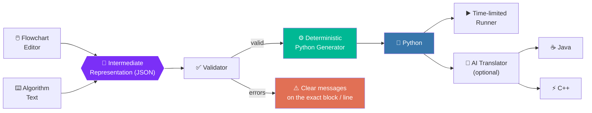
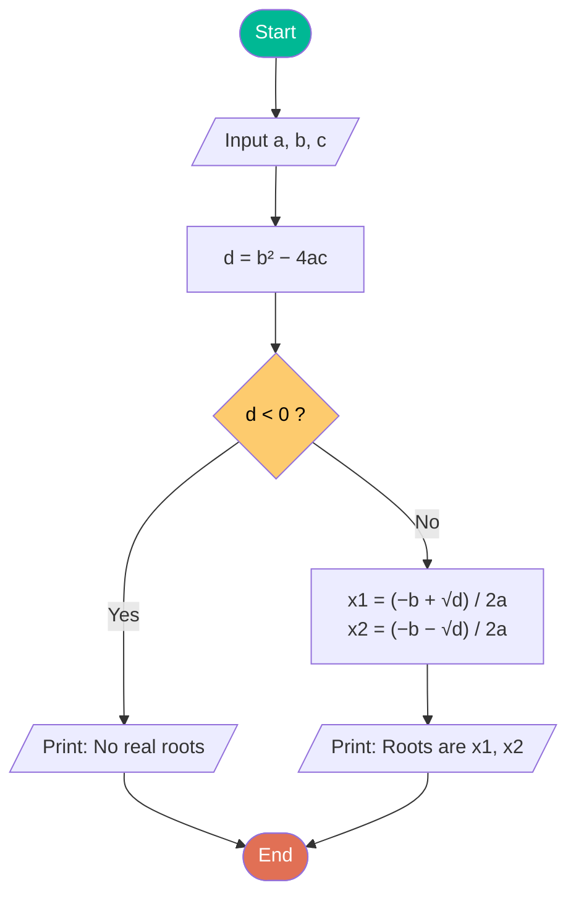

<p align="center">
  
</p>

<p align="center">
  
</p>

<p align="center">
  
  
  
  
  <br/>
  
  
  
  
</p>

<p align="center">
  <a href="#-about">About</a> •
  <a href="#-how-it-works">How it works</a> •
  <a href="#-features">Features</a> •
  <a href="#-math-formulas">Math</a> •
  <a href="#-examples">Examples</a> •
  <a href="#-quick-start">Quick start</a> •
  <a href="#-project-structure">Structure</a> •
  <a href="#-roadmap">Roadmap</a>
</p>

---

## 💫 About

**FlowCode** turns an algorithm into real, runnable code. Design it **visually** as a flowchart or **write it** as simple pseudocode — both are two views of the same algorithm, so you can switch any time without losing work.

> [!NOTE]
> FlowCode is **not** just an AI chat box. Python is produced by a **deterministic generator** (exact, testable, no guessing). AI is optional and is only used to translate the verified Python into **Java** or **C++**.

<table>
<tr>
<td align="center" width="25%">🖱️<br/><b>Draw</b><br/><sub>Drag blocks onto a canvas</sub></td>
<td align="center" width="25%">⌨️<br/><b>Write</b><br/><sub>Type START … END pseudocode</sub></td>
<td align="center" width="25%">➗<br/><b>Formulas</b><br/><sub>See textbook math as you type</sub></td>
<td align="center" width="25%">▶️<br/><b>Run</b><br/><sub>Generate code and execute it</sub></td>
</tr>
</table>

---

## 🔄 How It Works



| # | Stage | What happens |
|:-:|-------|--------------|
| 1️⃣ | **Input** | Draw blocks or type pseudocode — they stay in sync |
| 2️⃣ | **Represent** | Both become one language-independent JSON structure |
| 3️⃣ | **Validate** | Missing branches, unconnected blocks, undefined variables, bad expressions |
| 4️⃣ | **Generate** | Rule-based templates produce Python; AI can translate it to Java / C++ |
| 5️⃣ | **Run** | Python runs in a separate process with a timeout and output limit |

---

## 🔥 Features

<table>
<tr>
<td width="50%" valign="top">

### 🎨 Visual Flowchart Designer
Drag **Start · Input · Process · Decision · Loop · Output · End** blocks, connect them, and set variables, conditions and labels in the properties panel.

</td>
<td width="50%" valign="top">

### 📝 Algorithm (Pseudocode) Mode
Write `INPUT`, `SET`, `PRINT`, `IF`, `WHILE`, `FOR` — the flowchart is built and laid out for you.

</td>
</tr>
<tr>
<td width="50%" valign="top">

### ➗ Live Formula Preview
Type `(-b + sqrt(d)) / (2*a)` and instantly see the textbook formula, a plain-English sentence, and the exact Python it becomes.

</td>
<td width="50%" valign="top">

### 🛡️ Validation Engine
Every expression is parsed against a safe whitelist — **nothing is ever passed to `eval`/`exec`**. Errors point to the exact block or line.

</td>
</tr>
<tr>
<td width="50%" valign="top">

### 🤖 Pluggable AI
Use **Ollama** locally (private and free) or any **OpenAI-compatible API**. API keys stay on your machine and are never sent back to the browser.

</td>
<td width="50%" valign="top">

### 💾 Save · Autosave · Export
Projects are stored in SQLite, work is autosaved in the browser, and code can be copied or downloaded as `.py`, `.java` or `.cpp`.

</td>
</tr>
</table>

---

## ➗ Math Formulas

Type formulas as **plain text** — FlowCode shows them as **textbook math** (rendered with KaTeX, bundled for offline use) and turns them into correct code.

### ✨ One formula, four views

<table>
<tr><th>You type</th><td><code>(-b + sqrt(d)) / (2*a)</code></td></tr>
<tr><th>You see</th><td>

```math
\frac{-b + \sqrt{d}}{2a}
```

</td></tr>
<tr><th>In words</th><td><i>(negative b plus the square root of d) divided by (2 times a)</i></td></tr>
<tr><th>Python</th><td><code>(-b + math.sqrt(d)) / (2 * a)</code></td></tr>
</table>

### 📐 Supported notation

| Type this | Rendered as | Generated Python |
|-----------|:-----------:|------------------|
| `b^2 - 4*a*c` | $`b^{2} - 4a \cdot c`$ | `b ** 2 - 4 * a * c` |
| `(-b + sqrt(d)) / (2*a)` | $`\frac{-b + \sqrt{d}}{2a}`$ | `(-b + math.sqrt(d)) / (2 * a)` |
| `x^(1/3)` | $`\sqrt[3]{x}`$ | `x ** (1 / 3)` |
| `Sum(i, 1, n, i^2)` | $`\sum_{i=1}^{n} i^{2}`$ | `sum((i ** 2 for i in range(1, n + 1)))` |
| `Prod(i, 1, n, i)` | $`\prod_{i=1}^{n} i`$ | `math.prod((i for i in range(1, n + 1)))` |
| `factorial(n)` | $`n!`$ | `math.factorial(n)` |
| `n mod 2 = 0` | $`n \bmod 2 = 0`$ | `n % 2 == 0` |
| `(low + high) div 2` | $`\left\lfloor \frac{low + high}{2} \right\rfloor`$ | `(low + high) // 2` |
| `floor(x / 2)` | $`\left\lfloor \frac{x}{2} \right\rfloor`$ | `math.floor(x / 2)` |
| `abs(x - y)` | $`\lvert x - y \rvert`$ | `abs(x - y)` |
| `sin(pi / 2)` | $`\sin\left(\frac{\pi}{2}\right)`$ | `math.sin(math.pi / 2)` |
| `log(x) + exp(y)` | $`\ln(x) + e^{y}`$ | `math.log(x) + math.exp(y)` |
| `gcd(a, b)` | $`\gcd(a, b)`$ | `math.gcd(a, b)` |
| `x <= 10 and y != 0` | $`x \le 10 \;\text{and}\; y \ne 0`$ | `x <= 10 and y != 0` |

<details>
<summary><b>📚 All functions, constants and operators</b></summary>

<br/>

| Group | Available |
|-------|-----------|
| Arithmetic | `+` `-` `*` `/` `^` (power) · `mod` (remainder) · `div` (integer division) |
| Comparison | `=` `!=` `<` `<=` `>` `>=` · also `≤` `≥` `≠` |
| Logic | `and` `or` `not` · `true` `false` |
| Math functions | `sqrt` `floor` `ceil` `sin` `cos` `tan` `asin` `acos` `atan` `log` `log10` `exp` `factorial` `gcd` |
| Built-ins | `abs` `min` `max` `round` `int` `float` `str` `len` `pow` `sum` |
| Big operators | `Sum(i, first, last, formula)` → $`\sum`$ · `Prod(i, first, last, formula)` → $`\prod`$ |
| Constants | `pi` → $`\pi`$ · `e` |
| Symbols you can paste | `×` `÷` `−` `√` |

</details>

### 🧮 Classic formulas you can build

```math
\text{Quadratic roots:}\quad x = \frac{-b \pm \sqrt{b^{2} - 4ac}}{2a}
```

```math
\text{Distance:}\quad d = \sqrt{\left(x_{2} - x_{1}\right)^{2} + \left(y_{2} - y_{1}\right)^{2}}
```

```math
\text{Compound interest:}\quad A = P \cdot \left(1 + \frac{r}{n}\right)^{n \cdot t}
```

```math
\text{Average:}\quad \bar{m} = \frac{\sum_{i=1}^{n} m_{i}}{n}
\qquad
\text{Temperature:}\quad F = \frac{9}{5} \cdot C + 32
```

> [!TIP]
> `±` is not a single value, so write the quadratic formula as two assignments — one with `+` and one with `-` (see the example below).

---

## 🧪 Examples

<details open>
<summary><b>🔢 Quadratic equation — from algorithm to code</b></summary>

<br/>

<table>
<tr>
<th width="50%">✍️ Algorithm you write</th>
<th width="50%">🐍 Python FlowCode generates</th>
</tr>
<tr>
<td valign="top">

```text
START
INPUT a : float "Enter a"
INPUT b : float "Enter b"
INPUT c : float "Enter c"
SET d = b^2 - 4*a*c
IF d < 0 THEN
    PRINT "No real roots"
ELSE
    SET x1 = (-b + sqrt(d)) / (2*a)
    SET x2 = (-b - sqrt(d)) / (2*a)
    PRINT "Roots are", x1, x2
END IF
END
```

</td>
<td valign="top">

```python
# Program generated by FlowCode
import math

a = float(input('Enter a: '))
b = float(input('Enter b: '))
c = float(input('Enter c: '))
d = b ** 2 - 4 * a * c
if d < 0:
    print('No real roots')
else:
    x1 = (-b + math.sqrt(d)) / (2 * a)
    x2 = (-b - math.sqrt(d)) / (2 * a)
    print('Roots are', x1, x2)
```

</td>
</tr>
</table>

**The same algorithm as a flowchart:**



</details>

<details>
<summary><b>➕ Sum of 1 to n — loops</b></summary>

<br/>

```math
\text{total} = \sum_{i=1}^{n} i
```

<table>
<tr><th width="50%">✍️ Algorithm</th><th width="50%">🐍 Python</th></tr>
<tr>
<td valign="top">

```text
START
INPUT n : int "Enter n"
SET total = 0
FOR i FROM 1 TO n DO
    SET total = total + i
END FOR
PRINT "Sum is", total
END
```

</td>
<td valign="top">

```python
# Program generated by FlowCode

n = int(input('Enter n: '))
total = 0
for i in range(1, n + 1):
    total = total + i
print('Sum is', total)
```

</td>
</tr>
</table>

</details>

### 📚 Built-in example gallery

| | Example | Concepts |
|:-:|---------|----------|
| 🔢 | Even or odd | `IF … ELSE`, `mod` |
| ➕ | Sum of 1 to n | `FOR` loop, accumulator |
| ❗ | Factorial (while loop) | `WHILE` loop |
| 📐 | Quadratic equation | formulas, `sqrt` |
| 🫧 | Bubble sort | nested loops, lists |
| 🔍 | Binary search | `ELSE IF`, `div` |
| ✌️ | Add two numbers (one line) | multiple inputs |
| 📊 | Sum and average of many numbers | `sum`, `len` |

---

## 📖 Algorithm Syntax Cheat Sheet

| Construct | Syntax |
|-----------|--------|
| 🟢 Start / End | `START` … `END` |
| 📥 Input | `INPUT n` · `INPUT n : int "Prompt"` · `INPUT a, b : int` |
| 🧮 Assignment | `SET x = expr` · `x <- expr` · `x ← expr` |
| 📤 Output | `PRINT expr, "text", …` |
| 🔀 Decision | `IF cond THEN` … `ELSE IF cond THEN` … `ELSE` … `END IF` |
| 🔁 While loop | `WHILE cond DO` … `END WHILE` |
| 🔂 For loop | `FOR i FROM 1 TO n [STEP 1] DO` … `END FOR` |
| 💬 Comment | `// text` |

Types: `int` · `float` · `string` · `bool` · `list` — keywords are case-insensitive, and `=` inside a condition means *is equal to*.

---

## 🚀 Quick Start

### ⚡ One-click (Windows)

1. Install **Python 3.10+** and tick *Add python.exe to PATH*.
2. Double-click **`run.bat`**.

It creates the virtual environment, installs dependencies, starts the server and opens **http://127.0.0.1:5000** in your browser.

### 🛠️ Manual setup

```bash
# 1. Clone
git clone https://github.com/harshmogha/FlowCode.git
cd FlowCode

# 2. Virtual environment
python -m venv venv
venv\Scripts\activate          # Windows
# source venv/bin/activate     # macOS / Linux

# 3. Install and run
pip install -r requirements.txt
python app.py
```

Open **http://127.0.0.1:5000**. Use the `FLOWCODE_PORT` environment variable to change the port.

### 🤖 Enable AI for Java / C++ (optional)

<details>
<summary><b>🦙 Option A — Local with Ollama (private, free)</b></summary>

<br/>

1. Install [Ollama](https://ollama.com).
2. Pull a coding model:
   ```bash
   ollama pull qwen2.5-coder:7b
   ```
3. In FlowCode click the **AI badge → AI Settings**, choose *Ollama* and pick the model.

Suggested: `qwen2.5-coder:7b` · `qwen2.5-coder:3b` · `codellama:7b` · `deepseek-coder:6.7b`

</details>

<details>
<summary><b>☁️ Option B — Online (OpenAI-compatible API)</b></summary>

<br/>

Open **AI Settings**, choose *Online*, and enter the base URL, model (default `gpt-4o-mini`) and API key. Or use environment variables:

```bash
set AI_PROVIDER=openai
set OPENAI_API_KEY=your-key-here
set OPENAI_MODEL=gpt-4o-mini
```

> [!IMPORTANT]
> The key is saved only in `database/ai_settings.json`, which is **git-ignored** and never returned to the browser.

</details>

---

## 🧰 Tech Stack

<p align="center">
  
</p>

| Layer | Technology |
|-------|------------|
| 🖥️ Frontend | HTML5 · CSS3 · Vanilla JavaScript |
| ➗ Math rendering | KaTeX (bundled in `static/vendor/katex`) |
| ⚙️ Backend | Python · Flask 3.0.3 |
| 💾 Storage | SQLite (`database/projects.db`, created automatically) |
| 🤖 AI (optional) | Ollama or OpenAI-compatible API |
| 🧪 Testing | pytest |

---

## 📁 Project Structure

```text
FlowCode/
├── 📄 app.py                    # Flask app and API routes
├── 📄 requirements.txt          # Runtime dependency (Flask)
├── 📄 requirements-dev.txt      # Test dependencies
├── ▶️ run.bat / run_tests.bat   # Windows launchers
├── 🗄️ database/
│   └── db.py                    # SQLite project storage
├── ⚙️ services/
│   ├── algorithm_text.py        # Pseudocode ⇄ IR
│   ├── structure.py             # Builds the algorithm structure
│   ├── graph.py                 # Flowchart graph utilities
│   ├── flow_validator.py        # Graph validation
│   ├── expression.py            # Safe expression parsing (whitelist)
│   ├── formula_preview.py       # LaTeX + plain-English formula preview
│   ├── code_generator.py        # Deterministic Python generator
│   ├── executor.py              # Time-limited Python runner
│   ├── interactive.py           # Interactive run support
│   ├── ai_provider.py           # Ollama / online AI translation
│   ├── ai_settings.py           # Saved AI settings
│   ├── examples.py              # Built-in example algorithms
│   └── notes.py                 # Notes and explanations
├── 🎨 static/
│   ├── css/style.css
│   ├── js/                      # api.js · app.js · flowchart.js · formula.js
│   └── vendor/katex/            # Offline math rendering
├── 🖼️ templates/index.html       # Single-page UI
└── 🧪 tests/test_generator.py
```

---

## 🧪 Run the Tests

```bash
pip install -r requirements-dev.txt
pytest
```

Or double-click **`run_tests.bat`** on Windows.

---

## 🔒 Security

| ✅ Built in | Details |
|------------|---------|
| Safe expressions | Parsed with Python's `ast` against a whitelist — never `eval` / `exec` |
| Isolated runs | Separate isolated interpreter, temporary folder, **5 s timeout**, output size limit |
| Local only | Server binds to `127.0.0.1` |
| Secrets | API keys stored in a git-ignored file, never sent to the browser |

> [!WARNING]
> The code runner is a convenience for a **local, single-user learning tool** — it is **not a hardened sandbox**. Do not expose FlowCode to the public internet.

---

## 🗺️ Roadmap

- [x] Flowchart editor with validation
- [x] Algorithm text ⇄ flowchart sync
- [x] Live formula preview with KaTeX
- [x] Deterministic Python generation and in-app run
- [x] Java / C++ via AI translation
- [ ] Step-by-step execution tracing
- [ ] Automatic test-case generation
- [ ] Natural language → flowchart
- [ ] Matrices, integrals and limits

---

## ⚠️ Known Limitations

- Only the documented notation is supported — unknown symbols give a clear error instead of a guess.
- Write multiplication explicitly: `4*a*c`, not `4ac`.
- Java / C++ quality depends on the AI model, so review that output.
- Auto-layout of a flowchart generated from text may need manual tidying.

---

## 🤝 Contributing

1. 🍴 Fork the repository
2. 🌿 Create a branch: `git checkout -b feature/my-feature`
3. 💾 Commit: `git commit -m "Add my feature"`
4. 🚀 Push: `git push origin feature/my-feature`
5. 🔃 Open a Pull Request

---


<p align="center">
  <b>Made with ❤️ by <a href="https://github.com/harshmogha">Harsh Mogha</b><br/>
  <sub>If FlowCode helped you, please give it a ⭐</sub>
</p>

<p align="center">
  
</p>
